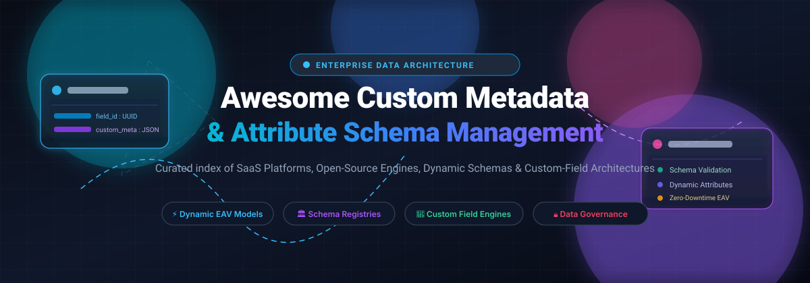

# Awesome Custom Metadata & Attribute Schema Management ⚡

<p align="center">
  
</p>

<p align="center">
  <a href="https://github.com/ishandutta2007/Awesome-Awesome-Awesome"></a>
  <a href="https://discord.gg/jc4xtF58Ve"></a>
  <a href="https://github.com/ishandutta2007/Awesome-Custom-Metadata-Attribute-Schema-Management/stargazers"></a>
  <a href="https://github.com/ishandutta2007/Awesome-Custom-Metadata-Attribute-Schema-Management/network/members"></a>
  <a href="https://github.com/ishandutta2007/Awesome-Custom-Metadata-Attribute-Schema-Management/blob/main/LICENSE"></a>
  <a href="https://github.com/ishandutta2007"></a>
</p>

---

## 📖 Curated Ecosystem: Custom Fields, Flexible Schemas & Data Model Extensions

> **A curated collection of SaaS platforms, open-source engines, schema registries, dynamic EAV models, and low-code data architecture frameworks for extending core data models without rigid database migrations.**

This repository tracks notable **SaaS enterprise platforms** and **active open-source projects** engineered for **Custom Metadata & Attribute Schema Management**. These solutions empower organizations to extend core schemas with custom fields, user-defined properties, and validation rules—adapting CRM, CLM, ERP, ITSM, and database platforms to bespoke business workflows with zero platform forks.

### 🎯 Key Architectural Focus Areas
- 🧩 **Custom Field Engines**: Extensible typed attributes (text, datetime, formulas, linked references, multiselect).
- ⚡ **Dynamic EAV & JSON Schemas**: High-performance Entity-Attribute-Value models, JSONB structures, and document schemas.
- 🏛️ **Schema Registries & Governance**: Versioning, compatibility enforcement (Avro/Protobuf/JSON), and schema drift prevention.
- 🌐 **Self-Hosted Data Sovereignty**: Production-grade open-source tools with GraphQL/REST APIs and no per-seat or per-object license caps.

---

## 📑 Table of Contents
- [📊 Sector Overview & Market Dynamics](#-sector-overview--market-dynamics)
- [☁️ SaaS & Hosted Enterprise Platforms](#️-saas--hosted-enterprise-platforms)
- [🔓 Open-Source GitHub Projects](#-open-source-github-projects)
- [🛠️ Architectural Guidance & Implementation Patterns](#️-architectural-guidance--implementation-patterns)
- [📈 Star History](#-star-history)
- [💖 Support & Sponsorship](#-support--sponsorship)
- [🤝 How to Contribute](#-how-to-contribute)
- [⚖️ Disclaimer](#️-disclaimer)

---

## 📊 Sector Overview & Market Dynamics

The global metadata management and extensible data modeling market is estimated at approximately **$14B to $15B** (projected to expand past **$60B+ by the early 2030s** at an estimated 20–25% CAGR as enterprise data volumes surge). 

The sector exhibits a **moderately fragmented yet top-heavy dynamic**:
- **At the Enterprise Top Tier**: Giants like Salesforce and ServiceNow capture dominant market share with mature, proprietary custom object and schema management engines baked directly into application platforms.
- **Across Mid-Market & Niche Domains**: The space remains highly competitive and fragmented across specialized Contract Lifecycle Management (CLM) suites, hybrid spreadsheet-database tools, and iPaaS providers.
- **In Open-Source & Modern Engineering**: Accelerating data sovereignty mandates and SaaS per-object/per-seat pricing caps are driving rapid adoption of open-source schema managers, headless data layers, and distributed schema registries.

---

## ☁️ SaaS & Hosted Enterprise Platforms

Enterprise SaaS solutions sorted descending by company scale (**valuation / market capitalization / revenue**):

| Product | Company Size (Valuation / Revenue) | Starting Pricing | Free Tier / Trial Limits | Description |
|---------|-----------------------------------|------------------|--------------------------|-------------|
| **[Salesforce Object Manager](https://www.salesforce.com/)** | **~$205B Market Cap** (~$41.5B ARR) | Platform Starter: **$25/user/month** (billed annually); Platform Plus: **$100/user/month** | **30-day free trial** with full Platform Starter features; no free-for-ever tier | Central console for defining custom objects, fields, and relationships. Custom field metadata is stored as `*.field-meta.xml` files and deployable via SFDX. Provides Fields & Relationships, validation rules, and page layouts. |
| **[ServiceNow Schema](https://www.servicenow.com/)** | **~$110B Market Cap** (~$15.4B ARR) | ITSM Fulfiller: **~$70/user/month** (enterprise contracts baseline ~$20,000–$50,000/yr minimum) | **No production free tier or trial**; free non-production Personal Developer Instances (PDIs) available for developers (reclaimed after 10 days of inactivity) | Table schema and CMDB class management. CI Class Manager provides an interface for modifying table relationships and inheritance hierarchies. Schema Map displays related tables across instances. |
| **[Docusign CLM Attribute Builder](https://www.docusign.com/)** | **~$12B Market Cap** (~$3.36B ARR) | Enterprise contract: **~$3,000/month** (~$36,000/year minimum contract baseline) | **No free tier or trial for CLM** (eSignature 30-day trial excludes CLM metadata/attribute tools) | Attribute definition and management for contract metadata. Admins create attribute groups and fields, link dropdown attributes to multiselect fields in Document Generation forms, and control field properties. |
| **[Workato Data Tables](https://www.workato.com/)** | **$5.7B Valuation** (~$150M+ ARR) | Pay-as-you-go / Pro: **$75/month** (includes 2,500 credits/month) | **Free tier forever**: 50,000 one-time credits with standard data table support (10,000 char/field limit; not relational) | Spreadsheet-like data store for workflow apps with columns (table structure) and rows (data). Supports text, number, date, and link-to-table column types. |
| **[Ironclad Data Manager](https://www.ironcladapp.com/)** | **$3.2B Valuation** (~$200M ARR) | Enterprise contract: **~$2,500/month** (~$30,000/year minimum contract baseline) | **No free tier or public self-serve free trial**; evaluation sandboxes provided via sales demo only | Contract metadata management console for defining custom properties (previously fields, metadata, or attributes). Admins can create new properties, deprecate unused ones, and merge properties of the same data type. |
| **[Airtable Field Manager](https://www.airtable.com/)** | **$2.25B Valuation** (~$480M ARR) | Team plan: **$20/seat/month** (billed annually) or $24/seat/month (monthly) | **Free tier forever**: Up to 1,000 records/base, 1 GB attachment storage, max 5 editors | Field configuration for Airtable bases. Supports 20+ field types including text, number, date, single/multi-select, linked records, attachments, formulas, rollups, and lookups. Field Manager tracks dependencies. |
| **[Quickbase Fields](https://www.quickbase.com/)** | **~$1.0B Valuation** (~$200M+ ARR) | Launch plan: **$99/month** (3 users, 1 builder, 1 app) | **Free tier forever**: 1 app, 1 builder, 3 users, 100 credits/month | Field type configuration for Quickbase operational apps. Supports user fields, file attachments (100 MB max), URL fields, report link fields for table relationships, and formula fields. |
| **[Agiloft Field Studio](https://www.agiloft.com/)** | **~$300M+ Est. Value (KKR Majority)** (~$50M+ ARR) | Essentials plan: **~$500/month** (~$6,000/year baseline; median enterprise rollout ~$25,000+/year) | **Astra Free Tier forever**: Unlimited users with Astra Word add-in; full CLM platform has **no free tier** | No-code field and table configuration for Agiloft CLM. Admins define custom fields, data types, and relationships without development assistance. |
| **[SmartSuite Fields](https://www.smartsuite.com/)** | **~$150M Valuation** (~$10M+ ARR) | Team plan: **$15/seat/month** (billed annually, 3-user minimum: $45/month) | **14-day free trial**: Access to all Professional features without requiring a credit card | Field customization with granular options: help text, default values, field-level permissions, and protected system fields. Changing field types attempts automated value conversion. |

---

## 🔓 Open-Source GitHub Projects

Self-hosted frameworks, dynamic database engines, active metadata platforms, and schema registries. Sorted descending by **GitHub Star Count**:

| Project | Star Badge | Description |
|---------|------------|-------------|
| **[Strapi](https://github.com/strapi/strapi)** | [](https://github.com/strapi/strapi/stargazers) | **Leading open-source headless CMS with visual Content-Type Builder.** Allows developers and content editors to dynamically add custom fields, define components, set up polymorphic relations, and generate automatic REST/GraphQL schemas with database migrations. |
| **[NocoDB](https://github.com/nocodb/nocodb)** | [](https://github.com/nocodb/nocodb/stargazers) | **Open-source Airtable alternative that turns any relational database into a smart spreadsheet.** Supports dynamic custom columns, attachment fields, ratings, JSON, formulas, and relational lookups/rollups over MySQL, PostgreSQL, SQL Server, and SQLite. |
| **[Twenty](https://github.com/twentyhq/twenty)** | [](https://github.com/twentyhq/twenty/stargazers) | **Full-featured modern open-source CRM with custom objects and extensible fields.** Users can create custom objects on the fly, add multi-type fields (text, number, date, selects), and manage relationships. Deactivating fields preserves underlying data and programmatic API access. |
| **[Directus](https://github.com/directus/directus)** | [](https://github.com/directus/directus/stargazers) | **Instant real-time data engine and data studio for SQL databases.** Dynamically configures schema definitions, field interfaces, relational displays, validation rules, and custom metadata layers directly on top of PostgreSQL, MySQL, SQLite, and Oracle without migrations locking the database. |
| **[OpenMetadata](https://github.com/open-metadata/OpenMetadata)** | [](https://github.com/open-metadata/OpenMetadata/stargazers) | **Unified metadata management platform with extensible custom attributes.** Features centralized schema definition, automated lineage tracking, custom glossary terms, and user-defined custom attributes across all data entities using JSON Schema standards. |
| **[DataHub](https://github.com/datahub-project/datahub)** | [](https://github.com/datahub-project/datahub/stargazers) | **Extensible open-source metadata platform developed originally by LinkedIn.** Utilizes a stream-based metadata architecture with flexible Metadata Change Proposals (MCP), user-defined tags, glossary terms, domain modeling, and dynamic schema versioning across data catalogs. |
| **[Buf](https://github.com/bufbuild/buf)** | [](https://github.com/bufbuild/buf/stargazers) | **Modern build tool, linter, and schema registry ecosystem for Protocol Buffers.** Provides strict schema compatibility enforcement, breaking-change detection, automated client code generation, and version-controlled API schema management across microservices. |
| **[Baserow](https://github.com/baserow/baserow)** | [](https://github.com/baserow/baserow/stargazers) | **Modular open-source no-code database with pluggable field architectures.** Offers native field types and a developer plugin API allowing creation of custom field types with proprietary validation and business rules. Backed by PostgreSQL and Django. |
| **[Amundsen](https://github.com/amundsen-io/amundsen)** | [](https://github.com/amundsen-io/amundsen/stargazers) | **Data discovery and metadata engine created at Lyft.** Leverages Neo4j or Apache Atlas graph backends to model schema relationships, table descriptions, column-level metadata, tags, and data lineage across enterprise data infrastructures. |
| **[Confluent Schema Registry](https://github.com/confluentinc/schema-registry)** | [](https://github.com/confluentinc/schema-registry/stargazers) | **Enterprise schema management service for event streams.** Provides a RESTful interface for storing and retrieving Avro, JSON Schema, and Protobuf definitions, enforcing backward, forward, and full compatibility across distributed event-driven systems. |
| **[Corteza](https://github.com/cortezaproject/corteza)** | [](https://github.com/cortezaproject/corteza/stargazers) | **100% open-source low-code platform for building enterprise record applications.** Features unlimited module and custom field definitions, flexible JSON-based data harmonization, role-based attribute permissions, and granular privacy controls. |
| **[OpenContracts](https://github.com/open-source-legal/opencontracts)** | [](https://github.com/open-source-legal/opencontracts/stargazers) | **Purpose-built contract metadata schema platform.** Supports corpus-scoped custom metadata columns across 12 distinct data types (JSON, choices, dates, numbers, text) with validation rules, GraphQL APIs, and Excel-style bulk attribute manipulation. |
| **[Raystack Stencil](https://github.com/raystack/stencil)** | [](https://github.com/raystack/stencil/stargazers) | **Dynamic schema registry for Protobuf, Avro, and JSON Schemas.** Features backward compatibility checks, version history, Docker deployments, and SDKs in Go and Java for client-side dynamic deserialization. |

---

## 🛠️ Architectural Guidance & Implementation Patterns

When designing custom metadata and attribute architectures, choose the design pattern that fits your scaling requirements:

```
┌────────────────────────────────────────────────────────────────────────┐
│               Schema Extension Architecture Patterns                   │
├────────────────────────────────────────────────────────────────────────┤
│ 1. EAV (Entity-Attribute-Value):                                       │
│    • Highest runtime flexibility                                       │
│    • Suitable for highly sparse attributes across millions of items    │
│    • Trade-off: Complex SQL joins & harder query indexing              │
│                                                                        │
│ 2. JSONB / Semi-Structured Document Columns:                           │
│    • Modern standard in PostgreSQL & MySQL 8+                          │
│    • GIN indexable with fast key-value lookups                         │
│    • Enforce schema constraints via application-layer JSON Schema      │
│                                                                        │
│ 3. Metadata Catalog & Registry (Active Metadata):                      │
│    • Decoupled schema governance for distributed microservices         │
│    • Enforces backward/forward evolution guarantees (Protobuf / Avro)  │
│    • Prevents pipeline breakage during upstream schema shifts          │
└────────────────────────────────────────────────────────────────────────┘
```

---

## 📈 Star History

[](https://www.star-history.com/#ishandutta2007/Awesome-Custom-Metadata-Attribute-Schema-Management&type=date&legend=top-left)

---

## 💖 Support & Sponsorship

If you find this curated ecosystem repository useful for your data architecture, research, or development projects, please consider supporting the project:

- ⭐ **Star this repository** to help others discover it on GitHub.
- 🍴 **Fork the repo** and contribute additions, corrections, and new platforms.
- 📢 **Share the project** with your engineering, data science, and product teams.
- ☕ **Buy me a coffee**: Support ongoing curation and open-source maintenance via the [GitHub Sponsors Dashboard](https://github.com/sponsors/ishandutta2007).

---

## 🤝 How to Contribute

Contributions are warmly welcomed! To propose additions or updates:

1. 🍴 **Fork** this repository.
2. 🌿 Create a descriptive branch: `git checkout -b add/new-schema-platform`.
3. 📝 Update `README.md` following the existing format (include product/repo name, official link, star badge if open-source, pricing, free tier details, and a concise 1–2 sentence description).
4. 🚀 Submit a **Pull Request** detailing why the entry belongs in this category.

---

## ⚖️ Disclaimer

- This repository is a **community-curated guide** intended for informational and educational purposes; inclusion does not constitute an endorsement.
- **Custom Field Limits & Quotas**: SaaS tiers and pricing models evolve frequently (e.g., Salesforce custom object limits, Airtable record caps, and Workato credit consumption). Open-source platforms eliminate per-seat licensing but require operational self-hosting infrastructure. Always verify official documentation before making production architectural decisions.

---

<p align="center">
  <b>Crafted with ❤️ for CRM architects, database engineers, data platform teams, and full-stack builders.</b>
</p>
